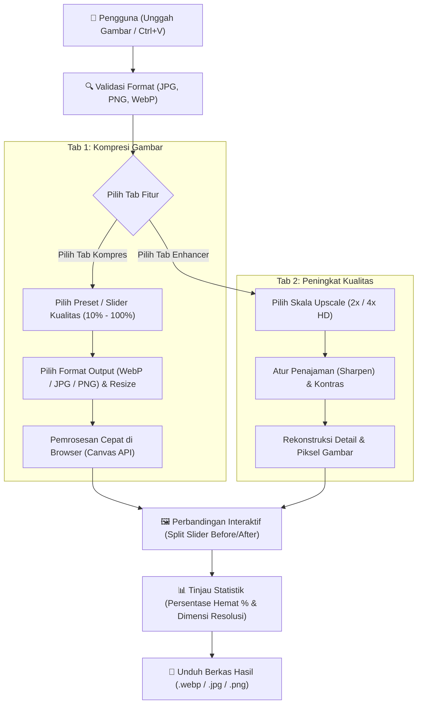

# 🎨 ImageCraft — Kompres & Peningkat Kualitas Gambar

<p align="center">
  
  
  
  
  
</p>

<p align="center">
  Aplikasi web modern, cepat, dan ringan untuk <b>mengompres ukuran file gambar</b> dan <b>meningkatkan kualitas serta resolusi gambar</b> (Super-Resolution). Seluruh proses berjalan <b>100% di browser lokal</b> tanpa mengirim gambar ke server luar, menjaga privasi sepenuhnya, dan bebas biaya hosting backend.
</p>

---

## 🔄 Alur Kerja Aplikasi (Workflow)

Berikut adalah diagram alur visual bagaimana data gambar diproses di dalam **ImageCraft**:



---

## ✨ Fitur-Fitur Utama

### 1. 🗜️ Kompresi Gambar Cerdas (Image Compressor)
* **Pangkas Ukuran Hingga 90%:** Mengurangi bobot file secara drastis tanpa penurunan kualitas kasat mata.
* **Preset Cepat Sekali Klik:**
  * 🌐 **Web & SEO:** Kualitas 80%, format WebP, dimensi 100% (ideal untuk performa loading website).
  * 📱 **Media Sosial:** Kualitas 85%, format JPG standar (optimal untuk Instagram/WhatsApp/Facebook).
  * ⚡ **Super Hemat:** Kualitas 50%, skala dimensi 75% (ukuran file paling minimal).
* **Slider Kualitas Fleksibel:** Atur kompresi manual dari 10% s.d. 100%.
* **Pengubahan Skala (Resize):** Pilihan cepat skala 25%, 50%, 75%, atau 100% dari resolusi asli.
* **Konversi Format:** Ubah otomatis ke format **WebP** (modern & hemat), **JPEG/JPG**, atau **PNG** (transparansi tetap terjaga).

### 2. 🪄 Peningkat Kualitas Gambar (AI Enhancer & Upscaler)
* **Upscale 2x & 4x:** Rekonstruksi piksel resolusi gambar buram atau kecil menjadi resolusi tinggi (HD).
* **Penajaman Kontur (Unsharp-Mask Convolution):** Mempertegas tepi dan detail objek foto yang kabur.
* **Penyeimbang Kontras:** Menyesuaikan kontras pencahayaan agar visual tampak lebih hidup.
* **Deteksi Gambar Besar Otomatis:** Memberikan peringatan pintar untuk gambar berdimensi tinggi (>2000px) agar memori grafis browser tetap lancar.

### 3. 🔍 Perbandingan Visual Interaktif (Before / After Slider)
* Geser garis pemisah secara horizontal untuk membandingkan perbedaan detail gambar sebelum vs sesudah pemrosesan secara *real-time*.
* Dilengkapi latar belakang bertekstur *checkerboard* sehingga gambar PNG transparan dapat dilihat dengan jelas.
* Statistik langsung: Perbandingan ukuran file (KB/MB), persentase hemat ukuran, dan perubahan resolusi piksel.

### 4. 📋 Fitur Paste Clipboard (`Ctrl + V`)
* Tidak perlu repot menyimpan screenshot ke folder terlebih dahulu. Cukup ambil tangkapan layar (PrintScreen/Snipping Tool) lalu tekan **Ctrl + V** di halaman web!

---

## 📊 Panduan Format Output & Rekomendasi

| Format | Ukuran Relatif | Transparansi | Rekomendasi Penggunaan |
| :--- | :--- | :---: | :--- |
| **WebP** | ⭐ Paling Ringkas (-80% s.d -90%) | ✅ Ya | Website, Blog, E-commerce, SEO Google PageSpeed |
| **JPEG / JPG** | Standar (-50% s.d -75%) | ❌ Tidak | Foto Dokumentasi, Media Sosial, Email Lampiran |
| **PNG** | Kualitas Asli (-30% s.d -60%) | ✅ Ya | Logo, Ikon, Grafis Vektor, Banner Transparan |
| **Upscale HD** | Resolusi bertambah 2x / 4x | ✅ Ya | Foto Buram, Restorasi Foto Lama, Cetak Gambar |

---

## 🛠️ Tech Stack & Arsitektur

* **Framework Frontend:** [React 18](https://react.dev/) + [TypeScript](https://www.typescriptlang.org/)
* **Bundler & Build Tool:** [Vite 6](https://vitejs.dev/)
* **Styling & UI:** [Tailwind CSS 3](https://tailwindcss.com/) + [Lucide Icons](https://lucide.dev/)
* **Engine Pemrosesan:** HTML5 Canvas API + [`browser-image-compression`](https://github.com/Donaldcwl/browser-image-compression)
* **Unit Testing:** [Vitest](https://vitest.dev/) + [Testing Library](https://testing-library.com/)

---

## 🚀 Panduan Memulai

### 1. Prasyarat
Pastikan komputer Anda telah terpasang:
* [Node.js](https://nodejs.org/) (versi 18 ke atas disarankan)
* [Laragon](https://laragon.org/) (opsional, jika ingin dijalankan via web server lokal Windows)

### 2. Instalasi Dependensi
Buka terminal di folder proyek (`c:\laragon\www\convert-gambar`) lalu jalankan:

```bash
npm install
```

### 3. Menjalankan Mode Development (Live Reload)
Untuk pengembangan dengan fitur live reload instan:

```bash
npm run dev
```
Buka URL lokal yang muncul di terminal (biasanya `http://localhost:5173` atau `http://localhost:5174`).

### 4. Menjalankan via Laragon (Apache)
Proyek ini sudah dilengkapi file build produksi di folder `dist/` dan file penghubung `index.php`. Jika Laragon sedang aktif, Anda bisa langsung mengakses:

👉 **`http://localhost/convert-gambar/`** atau **`http://convert-gambar.test/`**

Jika Anda melakukan perubahan kode, perbarui build produksi dengan perintah:
```bash
npm run build
```

---

## 🧪 Menjalankan Pengujian (Unit Tests)

Proyek ini telah dilengkapi serangkaian pengujian unit test otomatis untuk memvalidasi helper ukuran file, kalkulasi resolusi, penamaan file, dan kalkulasi upscale:

```bash
npm test
```

---

## 📁 Struktur Direktori

```text
convert-gambar/
├── docs/                   # Spesifikasi teknis dan rencana implementasi
├── dist/                   # File siap pakai untuk hosting / Laragon (HTML/CSS/JS)
├── public/                 # Aset statis publik
├── src/
│   ├── components/
│   │   ├── common/         # Dropzone (upload/paste), ComparisonSlider, StatsBadge
│   │   ├── compressor/     # CompressorView & CompressControls
│   │   ├── enhancer/       # EnhancerView & EnhanceControls
│   │   └── layout/         # Navbar & TabNav
│   ├── lib/
│   │   ├── imageCompressor.ts  # Logika kompresi & konversi format
│   │   ├── imageEnhancer.ts    # Logika super-resolution & sharpening
│   │   └── utils.ts            # Helper formatting bytes, download, dimensi
│   ├── types/              # Definisi interface TypeScript
│   ├── App.tsx             # Root component SPA
│   ├── main.tsx            # Entry point React
│   └── index.css           # Konfigurasi Tailwind & styling custom
├── tests/                  # Unit test (Vitest)
├── index.php               # Jembatan akses otomatis untuk Laragon Apache
├── README.md               # Dokumentasi resmi & panduan alur proyek
├── package.json            # Konfigurasi dependensi dan skrip npm
├── tailwind.config.js      # Konfigurasi Tailwind CSS
└── vite.config.ts          # Konfigurasi Vite & base path relatif
```

---

## 🔒 Privasi & Keamanan Data

Aplikasi ini mengusung prinsip **Privacy-First**:
* Gambar yang Anda olah **tidak pernah dikirim ke cloud, database, atau server pihak ketiga**.
* Seluruh operasi piksel diproses secara mandiri di memori RAM dan GPU perangkat Anda melalui WebAssembly dan Canvas API.
* URL Blob memori browser selalu dibersihkan secara otomatis (`URL.revokeObjectURL`) untuk mencegah kebocoran memori perangkat.

---

<p align="center">
  Dibuat dengan ❤️ untuk kemudahan pengolahan gambar yang cepat, privat, dan efisien.
</p>
